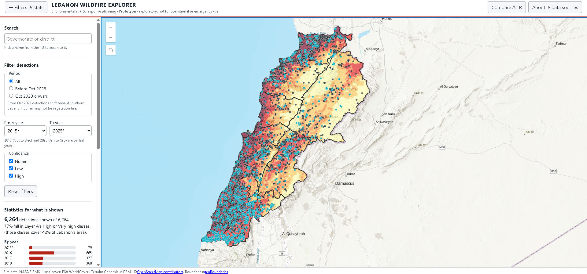
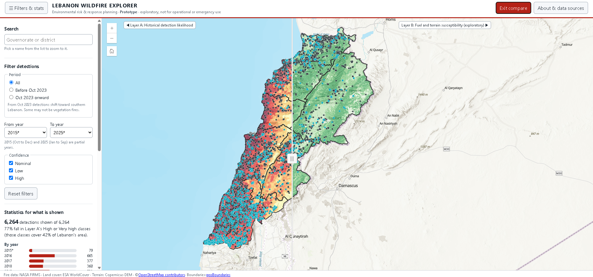

# Lebanon Wildfire Explorer

An exploratory web GIS project on satellite-observed fire detections in Lebanon (2015 to 2025). A documented QGIS analysis feeds an interactive map built with the ArcGIS Maps SDK for JavaScript.

> **Prototype. Exploratory, not for operational or emergency use.** Fire detections are satellite hotspots, not confirmed wildfires. Neither layer is a validated wildfire prediction. NASA advises against using these data for tactical decision-making or for conditions at a local scale.

**Live demo:** `https://github.com/Hadi-M005/Lebanon-Wildfire-GIS.git`



## What it does

- Shows 6,264 VIIRS fire detections (wildfire-type, clipped to Lebanon) with pop-ups.
- Two separate analysis layers, with a swipe tool to compare them:
  - **Layer A, historical detection likelihood** (data-driven)
  - **Layer B, fuel and terrain susceptibility** (expert-scored, exploratory)
- Governorate and district boundaries with detection counts, densities and layer statistics.
- Filters by period, year and confidence, with statistics that update with the filters.
- Search for governorates and districts.



## Key findings

- Fire season runs June to October. Among full years, 2024 has the most detections, followed by 2021.
- From October 2023 detections shift markedly toward southern Lebanon (for example, Liban-Sud goes from about 9 to about 26 detections per 100 km² per year). The satellite data cannot show what caused any individual hotspot, and some of these detections may not be vegetation fires.
- Detections follow **elevation and nearness to buildings** much more than slope or land cover. They are about 2.5 times more frequent than area alone predicts below 200 m and about a tenth as frequent above 1,500 m.
- Layer A, built from elevation and distance to buildings, reaches an AUC of about 0.74 on held-out years (2022 to September 2023) and about 0.72 from October 2023 onward. It reflects human presence as much as vegetation.
- Layer B (fuel from land cover, plus slope) does not match where detections occur (AUC about 0.47 to 0.50, no better than chance), and its class areas are very sensitive to the scoring assumptions. It was deliberately not tuned to the detections.

Details are in [`docs/methodology.md`](docs/methodology.md) and [`docs/limitations.md`](docs/limitations.md).

## Data

| Dataset | Provider |
|---|---|
| Fire detections, VIIRS Suomi NPP | NASA FIRMS |
| Land cover, WorldCover 2021 v200 | ESA / VITO (CC BY 4.0) |
| Elevation, Copernicus DEM GLO-30 | Copernicus / ESA |
| Roads, buildings, places | OpenStreetMap contributors (ODbL), via Geofabrik |
| Administrative boundaries | geoBoundaries (Public Domain per metadata) |
| Basemap and SDK | Esri |

Full credits, licences and required notices: [`LICENSES-AND-SOURCES.md`](LICENSES-AND-SOURCES.md). The dataset inventory is in [`data/metadata/dataset-inventory.md`](data/metadata/dataset-inventory.md).

## Method in brief

1. Audited three FIRMS sensors and chose Suomi NPP VIIRS. Kept presumed vegetation fires (`type = 0`), clipped to Lebanon, and split the data at October 2023.
2. Derived elevation, slope and hillshade from the Copernicus DEM and clipped WorldCover to Lebanon (QGIS).
3. Compared the distribution of detections with the whole country for each factor, using a random-point baseline for land cover.
4. Built Layer A from frequency ratios calibrated on 2016 to 2021 and tested on held-out years. Built Layer B from expert scores and tested its sensitivity.
5. Summarised detections and layer classes by governorate and district, and exported lightweight GeoJSON for the web app.

## Run it locally

1. Clone the repository.
2. Create an ArcGIS Location Platform API key limited to the **Basemap styles service** and to the referrer `http://127.0.0.1:5500`.
3. Copy `js/config.local.example.js` to `js/config.local.js` and paste the key.
4. Serve the folder with a local web server (for example the VS Code **Live Server** extension) and open `http://127.0.0.1:5500`. Opening `index.html` directly will not load the data.

## Repository layout

```
index.html, css/, js/     web application
data/app/                 GeoJSON and JSON files used by the app
data/metadata/            dataset inventory
docs/                     methodology, limitations, screenshots
LICENSES-AND-SOURCES.md   credits, licences and required notices
```

Raw downloads and large rasters are not stored in this repository (see `.gitignore`). They can be re-downloaded from the sources above.

## Limitations (short version)

Hotspots are not fires. Built-up land is over-represented among detections, which points to non-wildland burning. Layer A reflects where detections have occurred, not where fires will occur. Layer B is unvalidated. The boundary layers are digitized from map images and have limited positional accuracy. See [`docs/limitations.md`](docs/limitations.md).

   ## Planned next
   - Add the analysis scripts so every figure can be reproduced from the raw downloads.
   - Validate against independent data such as burned-area products or incident records.

## Licence

Code: `MIT`. Data and derived layers carry the licences and notices listed in `LICENSES-AND-SOURCES.md`.

## Author

`Hadi Mourad` &middot; `hadimrad007@gmail.com`
